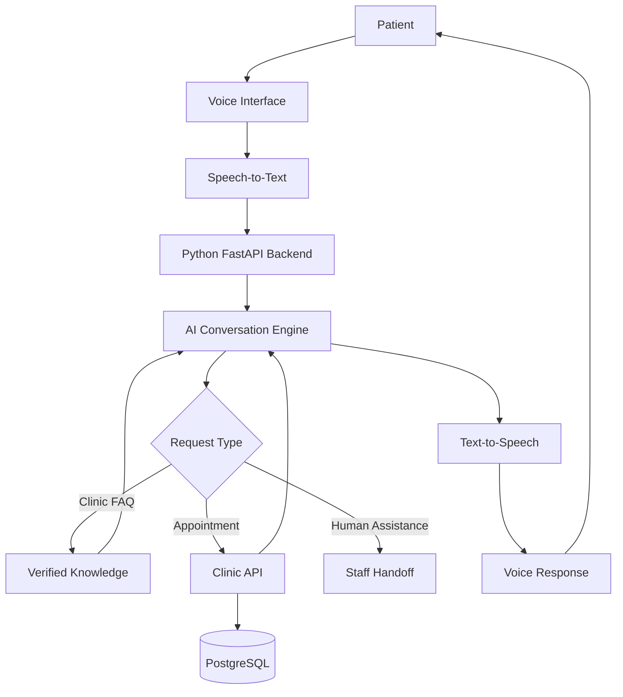

# 🩺 Clinic Voice Agent
### AI-Powered Voice Receptionist for Clinics

<p align="center">
  <strong>Making clinic interactions more accessible through conversational AI.</strong>
</p>

<p align="center">
  An AI engineering project exploring voice conversations, intelligent request handling, and clinic workflow automation.
</p>

<p align="center">
  <a href="https://github.com/vishwajeethshikari/clinic-voice-agent">GitHub Repository</a> ·
  <a href="https://github.com/vishwajeethshikari">Developer Profile</a>
</p>

---

## 📌 Overview

**Clinic Voice Agent** is a voice-first AI receptionist designed to help clinics handle routine patient interactions more efficiently.

Instead of requiring every patient to make a traditional phone call and wait for a staff member, the system aims to let patients communicate naturally with an AI assistant to request clinic information, ask about appointments, and access supported services.

The project is part of my journey toward building practical AI engineering systems that combine large language models, speech processing, backend APIs, and database integration.

### 🎯 The Problem

Clinics frequently handle repetitive tasks such as:

- Answering questions about clinic timings and services.
- Responding to appointment-related inquiries.
- Managing requests to book, reschedule, or cancel appointments.
- Handling routine calls while staff attend to patients.
- Providing consistent information to callers.

These repetitive interactions can increase staff workload and create delays for patients.

### 💡 The Solution

Clinic Voice Agent aims to provide an AI-powered receptionist that can understand patient requests, respond conversationally, and connect to authorized clinic workflows.

The long-term goal is to build a reliable, low-latency voice agent that can assist patients while allowing clinic staff to focus on tasks that require human attention.

---

## ✨ Core Capabilities

The following capabilities define the project direction. Their implementation status should be updated as development progresses.

| Capability | Description |
|---|---|
| 🎙️ Voice interaction | Allow patients to communicate through speech |
| 🧠 AI conversation | Understand user intent and generate relevant responses |
| 🗣️ Speech recognition | Convert spoken requests into text |
| 🔊 Voice responses | Deliver assistant replies through synthesized speech |
| 📅 Appointment workflows | Support booking, rescheduling, and cancellation through validated backend operations |
| 🏥 Clinic information | Answer questions using verified clinic information |
| 👩‍⚕️ Human handoff | Escalate requests that need staff assistance |
| 📝 Call summaries | Generate concise summaries for authorized clinic staff |

> **Implementation note:** These are target capabilities, not a claim that every feature is already implemented.

---

## 🏗️ System Architecture

The intended architecture separates voice interaction, AI reasoning, and clinic operations so that each component can evolve independently.



### Architecture Components

- **Voice interface:** Captures patient requests and plays responses.
- **Speech processing:** Converts voice into text and generated responses into audio.
- **AI conversation engine:** Interprets requests and determines the next action.
- **FastAPI backend:** Exposes application endpoints and coordinates AI services.
- **Clinic API:** Performs authorized operations such as appointment management.
- **PostgreSQL:** Stores application data when database integration is implemented.
- **Human handoff:** Provides a path to clinic staff for unsupported or sensitive requests.

The diagram represents the target design. The actual implementation may contain fewer components during the prototype stage.

---

## 🛠️ Technology Stack

The planned stack is designed to support AI development and future integration with production-style backend services.

| Layer | Technology |
|---|---|
| AI backend | Python, FastAPI |
| Language understanding | LLM integration |
| Speech input | Speech-to-text provider |
| Speech output | Text-to-speech provider |
| Frontend dashboard | React, planned |
| Database | PostgreSQL, planned |
| Telephony | Twilio Voice, planned |
| Backend integrations | REST APIs |
| Version control | Git and GitHub |
| Deployment | To be selected |

Technologies should be marked as implemented only when they are present and configured in the repository.

---

## 🔄 How It Works

The intended interaction flow is:

1. **Patient speaks:** The patient asks a question or requests an appointment.
2. **Speech is transcribed:** A speech recognition service converts the audio into text.
3. **Intent is identified:** The AI determines whether the request concerns clinic information, appointments, or human assistance.
4. **Action is validated:** If a clinic operation is requested, the backend validates the input and invokes an authorized API.
5. **Response is generated:** The assistant prepares a relevant response using verified information.
6. **Patient receives an answer:** The response is returned as text and/or speech.

For example, a patient could ask about the clinic's working hours. The assistant should answer using configured clinic information rather than inventing a schedule.

Appointment operations should be confirmed only after the backend verifies that the requested action succeeded.

---

## 🔐 Security and Reliability

Healthcare-related applications require particular care when handling personal information.

The project should incorporate:

- Secure management of API keys and environment variables.
- Input validation and appropriate API authentication.
- Restricted access to patient and appointment information.
- Minimal collection and retention of sensitive data.
- Protection against unauthorized appointment changes.
- Clear handling of failed requests and unavailable services.
- Human escalation when the assistant cannot safely handle a request.

The assistant is intended for administrative assistance, not autonomous diagnosis, treatment recommendations, or emergency medical decision-making.

---

## 🚀 Getting Started

### Prerequisites

Install the dependencies required by the implementation:

- Git
- Python 3.10 or later, if supported by the project dependencies
- A configured AI or speech service, if required
- Node.js and npm, if a React frontend is present
- PostgreSQL, if database integration is implemented

### 1. Clone the repository

```bash
git clone https://github.com/vishwajeethshikari/clinic-voice-agent.git
cd clinic-voice-agent
```

### 2. Create a Python virtual environment

For Windows:

```bash
python -m venv .venv
.venv\Scripts\activate
```

For Linux or macOS:

```bash
python3 -m venv .venv
source .venv/bin/activate
```

### 3. Install dependencies

If the repository contains `requirements.txt`:

```bash
pip install -r requirements.txt
```

### 4. Configure environment variables

Create a `.env` file using the variables required by the actual application.

Example placeholders:

```env
LLM_API_KEY=your_api_key
STT_API_KEY=your_speech_to_text_key
TTS_API_KEY=your_text_to_speech_key
DATABASE_URL=your_database_url
```

Only configure the variables needed by your implementation. Do not commit `.env` or real credentials to GitHub.

### 5. Run the backend

If the entry point is `main.py` and the FastAPI instance is named `app`, the command is:

```bash
python -m uvicorn main:app --reload --port 8000
```

The command must be adjusted if your application uses a different entry point or module structure.

---

## 📂 Suggested Repository Structure

```text
clinic-voice-agent/
│
├── backend/
│   ├── app/
│   │   ├── main.py
│   │   ├── api/
│   │   ├── services/
│   │   ├── ai/
│   │   └── config.py
│   ├── tests/
│   └── requirements.txt
│
├── frontend/
│   ├── src/
│   └── package.json
│
├── docs/
│   └── architecture.md
│
├── .env.example
├── .gitignore
├── README.md
└── LICENSE
```

This is a proposed structure. Keep it aligned with the actual files in the repository.

---

## 🗺️ Development Roadmap

- [ ] Set up the backend and configuration.
- [ ] Implement a basic conversational API.
- [ ] Integrate speech-to-text.
- [ ] Integrate text-to-speech.
- [ ] Add verified clinic FAQs.
- [ ] Design and implement appointment APIs.
- [ ] Integrate PostgreSQL for persistent data.
- [ ] Build a React dashboard for clinic staff.
- [ ] Add call history and conversation summaries.
- [ ] Integrate telephone calls through a supported telephony provider.
- [ ] Implement authentication, testing, and monitoring.
- [ ] Deploy the application and document a working demonstration.

Update the checklist as each capability is implemented and tested.

---

## 🧪 Testing Strategy

The project should be tested across the complete interaction flow.

- **API tests:** Verify request validation and response formats.
- **Conversation tests:** Check how the assistant handles common clinic questions.
- **Speech tests:** Evaluate transcription quality and generated audio.
- **Integration tests:** Verify communication between the AI backend and clinic APIs.
- **Failure tests:** Test timeouts, unavailable services, and invalid inputs.
- **Security tests:** Verify access controls and protection of sensitive data.

Performance and accuracy metrics should be added after collecting actual test results.

---

## 🔮 Future Enhancements

Potential future improvements include:

- Real-time voice conversations with lower latency.
- Multilingual support for Indian languages.
- Retrieval-augmented generation (RAG) for clinic documentation.
- Reliable appointment scheduling and conflict detection.
- Integration with clinic management systems.
- Call transfers and staff escalation.
- Docker-based deployment.
- Automated evaluation of conversation quality.
- Observability, structured logs, and service monitoring.

---

## 👨‍💻 Author

**Shikari Vishwajeeth**

AI engineering enthusiast focused on backend development, intelligent automation, and practical AI applications.

- **GitHub:** [@vishwajeethshikari](https://github.com/vishwajeethshikari)
- **Repository:** [clinic-voice-agent](https://github.com/vishwajeethshikari/clinic-voice-agent)

---

## 📄 License

This project can be distributed under the MIT License if that matches your intended usage. Add a complete `LICENSE` file before claiming the repository is MIT-licensed.

---

<p align="center">
  <strong>Clinic Voice Agent</strong><br/>
  Building more accessible clinic interactions through conversational AI.
</p>
